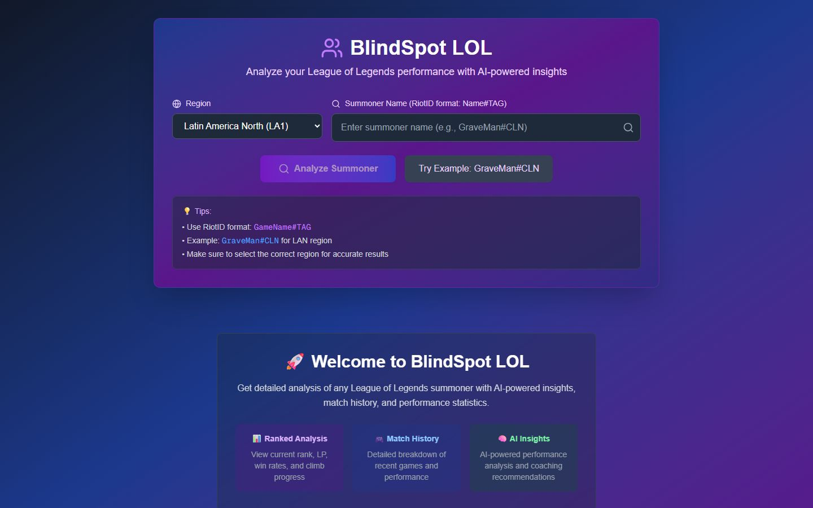
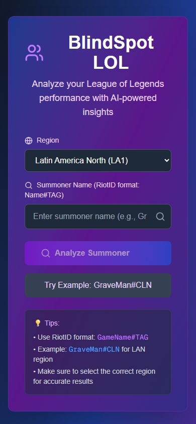

# BlindSpot LOL

Analizador de jugadores de League of Legends con inteligencia artificial. Buscas a un invocador por su RiotID y la app muestra sus estadísticas de las últimas 20 partidas y un análisis personalizado con fortalezas, debilidades y recomendaciones. Es para jugadores que quieren entender en qué mejorar.

| Escritorio | Móvil |
| --- | --- |
|  |  |

<sub>Las capturas muestran la pantalla de búsqueda. Los resultados necesitan llaves de Riot y de Groq y una base de datos MySQL.</sub>

## Qué hace

- Búsqueda de invocador por nombre con etiqueta (por ejemplo `Nombre#TAG`) y región.
- Estadísticas de rendimiento: KDA, porcentaje de victorias y campeones más jugados, a partir de 20 partidas.
- Análisis con IA con formato markdown y colores por tema.
- Coach virtual para hacer preguntas sobre tu forma de jugar.
- Recomendaciones de campeones con IA.
- Historial de búsquedas y opción de compartir el análisis.

## Tecnologías

- Frontend: Next.js 15, React 19, TypeScript, Tailwind CSS, TanStack Query.
- Backend: Node.js, Express, TypeScript, MySQL 8.
- IA: API de Groq con un modelo Llama 3.
- Datos de juego: API de Riot Games.

## Cómo correrlo

Necesitas Node.js, MySQL 8 (o Docker) y llaves de Riot Games y de Groq.

Base de datos con Docker y migraciones:

```bash
docker compose -f docker-compose.dev.yml up -d mysql
cd backend && npm install && cp .env.example .env
npm run migrate
```

Backend en el puerto 3001:

```bash
cd backend && npm run dev
```

Frontend en el puerto 3000:

```bash
cd frontend && npm install && npm run dev
```

Variables de entorno del backend (`backend/.env`): `RIOT_API_KEY`, `AI_API_KEY`, `AI_API_PROVIDER`, `AI_MODEL`, `DB_HOST`, `DB_PORT`, `DB_USER`, `DB_PASSWORD`, `DB_NAME` y `FRONTEND_URL`.

## Documentación

En `docs/` hay notas sobre los endpoints de la API, el análisis de datos con IA y el sistema de análisis del meta.
